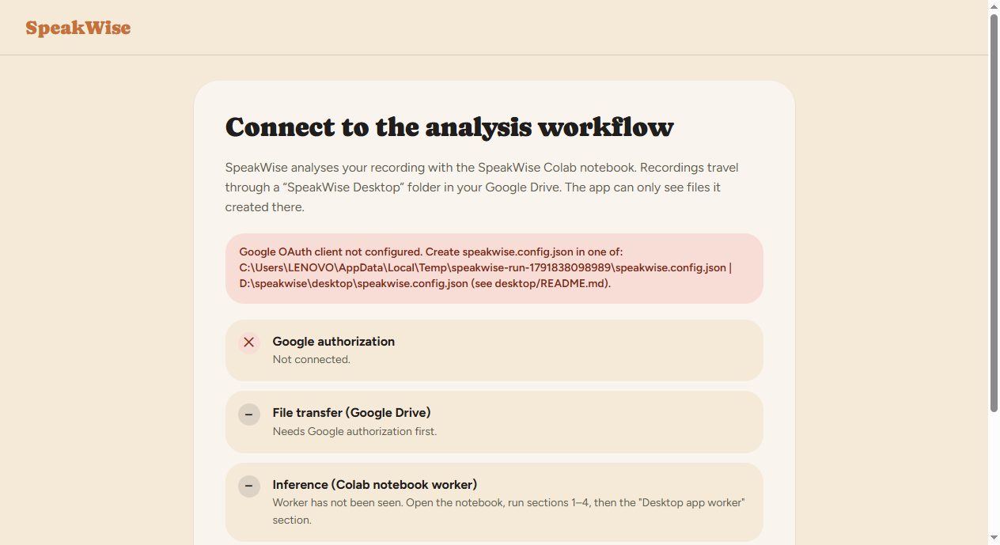
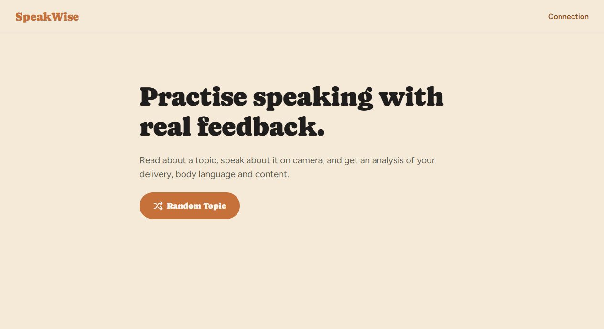
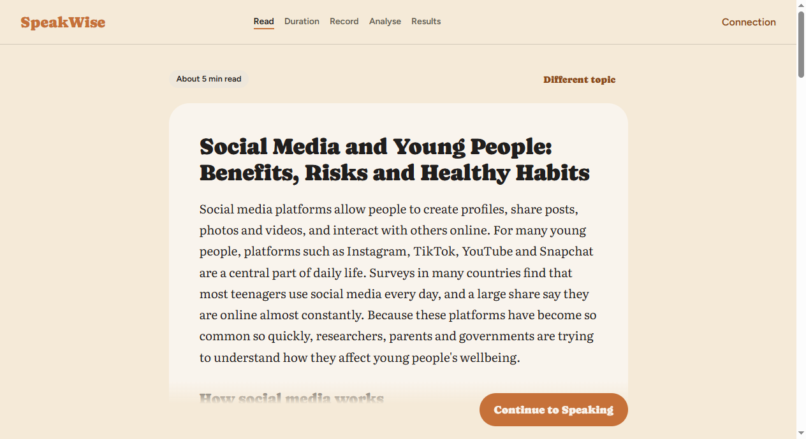
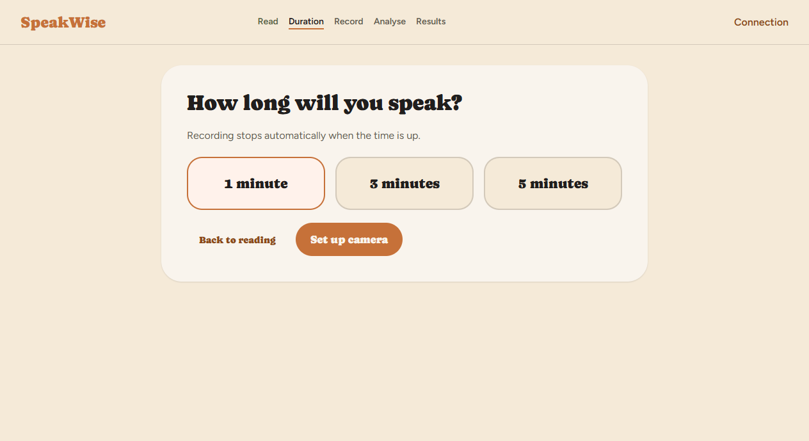
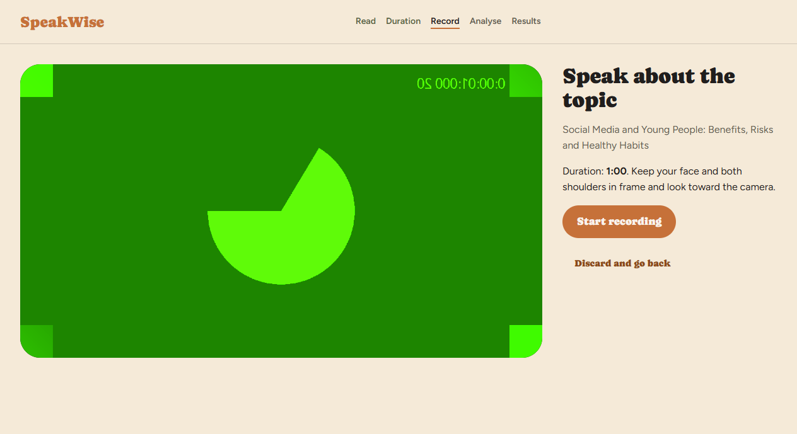
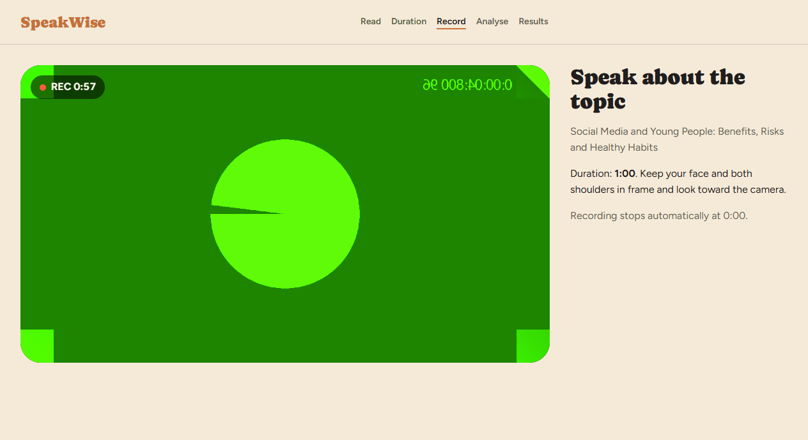
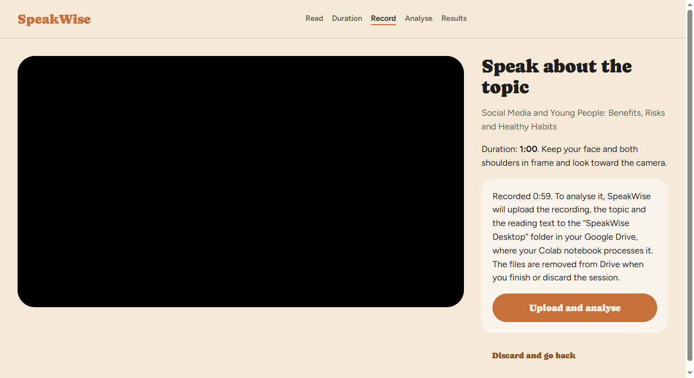
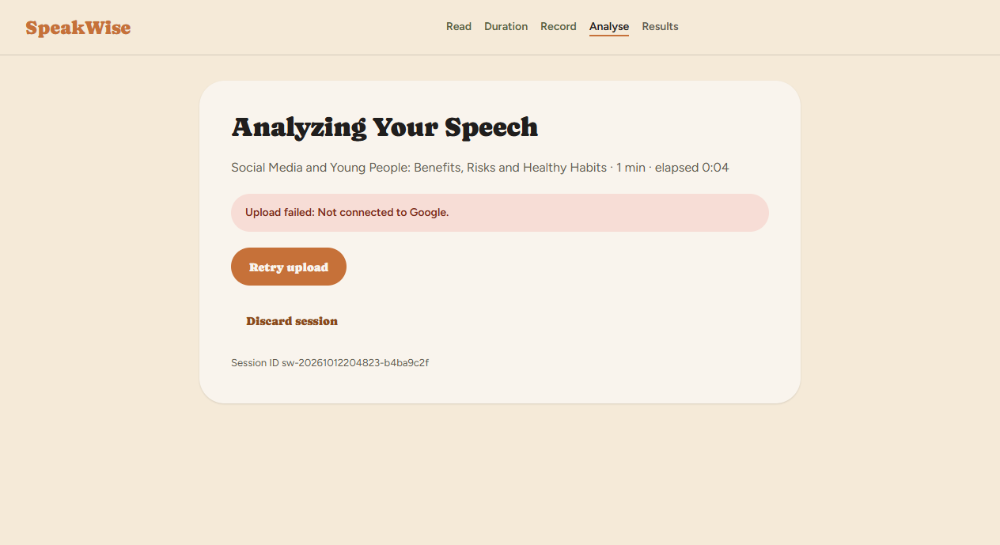

# SpeakWise Desktop App: Setup, Colab Connection and Demo Guide

This guide takes you from a fresh clone to a full demo: record a speech in the desktop app, analyse it with
the SpeakWise pipeline on Google Colab, and see the real report in the app.

- [1. How it works](#1-how-it-works)
- [2. What you need](#2-what-you-need)
- [3. Install the app](#3-install-the-app)
- [4. Create the Google OAuth client (one-off)](#4-create-the-google-oauth-client-one-off)
- [5. Configure the app](#5-configure-the-app)
- [6. Prepare the Colab notebook](#6-prepare-the-colab-notebook)
- [7. Run the demo](#7-run-the-demo)
- [8. Screenshots](#8-screenshots)
- [9. Troubleshooting](#9-troubleshooting)
- [10. Checks and tests](#10-checks-and-tests)
- [11. Known limitations](#11-known-limitations)

---

## 1. How it works

```
 Desktop app (Windows)                    Google Drive                      Google Colab (GPU)
 ─────────────────────                    ────────────                      ──────────────────
 Random topic → read → 1/3/5 min
 Webcam + mic recording (MP4)
 "Upload and analyse"  ──────────►  SpeakWise Desktop/
                                      recording_<id>.mp4
                                      session_<id>.json   ◄── worker cell polls every 15 s
                                      report_<id>.json (pending)        │
                                                                         ▼
                                                              process_session(mp4, topic,
                                                                reading text, duration)
                                      report_<id>.json  ◄──────────────  writes the real report
 Polls every 10 s, validates  ◄────   (status: done)
 Dashboard of the real report
 "Start New Session" → deletes the session's files locally and in Drive
```

- **No model runs on the laptop.** All speech and video analysis runs in Colab.
- **The notebook has no remote API.** Uploading to Drive does **not** start Colab on its own. Someone
  must run the notebook's **"13. Desktop app worker"** cell, which keeps watching Drive while it runs.
  The app shows clearly whether that worker is online.
- The app uses the `drive.file` Google scope, so it can only see files **it created**. It cannot read the
  rest of your Drive.
- Before showing results, the app checks the report's session ID, topic, a SHA-256 hash of the exact
  reading text, the schema version, and that every metric's value matches its status. If any check fails,
  it shows an error, never fake results.

## 2. What you need

| Item | Notes |
|---|---|
| Windows 10/11 PC with webcam + microphone | The app needs both. |
| **Node.js 22 or newer** | `node --version`. Download from nodejs.org if missing. |
| Git | To clone the repository. |
| A Google account | Used for **both** the desktop app and Colab. **It must be the same account.** |
| Google Cloud project | Free. Needed once to create the OAuth client (section 4). |
| Internet | For Drive upload and Colab. |

FFmpeg does not need to be installed. The app ships its own copy (`ffmpeg-static`) to convert recordings to MP4.

## 3. Install the app

```powershell
git clone https://github.com/pranjalsonar/SpeakWise.git
cd SpeakWise
git checkout backend-auth-api      # branch with the desktop app (until merged to main)

cd desktop
npm install                        # Electron + ffmpeg
npm --prefix ../frontend install   # the React UI the app reuses
```

## 4. Create the Google OAuth client (one-off)

The app signs in through your normal browser and never asks for your password.

1. Open <https://console.cloud.google.com/> and create a project (e.g. `speakwise-desktop`).
2. **APIs & Services → Library**: search for **Google Drive API** and click **Enable**.
3. **APIs & Services → OAuth consent screen** (also called "Google Auth Platform"):
   - User type: **External**. App name: `SpeakWise Desktop`. Fill in the support and developer emails.
   - **Data access / Scopes:** add `https://www.googleapis.com/auth/drive.file`.
   - **Audience / Test users:** add every Google account that will use the app (e.g. your college
     account). In *Testing* mode, only these accounts can sign in.
4. **APIs & Services → Credentials → Create credentials → OAuth client ID**:
   - Application type: **Desktop app**. Name: `SpeakWise Desktop`.
   - Copy the **Client ID** and **Client secret**.

> For Desktop-app clients, Google does not treat the client secret as confidential, but still keep it
> out of Git. The config file below is already in `.gitignore`.

## 5. Configure the app

In the `desktop` folder, copy the example config and fill it in:

```powershell
cd desktop
Copy-Item speakwise.config.example.json speakwise.config.json
notepad speakwise.config.json
```

```json
{
  "googleClientId": "1234567890-abc.apps.googleusercontent.com",
  "googleClientSecret": "GOCSPX-...",
  "colabNotebookUrl": "https://colab.research.google.com/github/pranjalsonar/SpeakWise/blob/backend-auth-api/speakwise_pipeline/notebooks/speakwise_pipeline_colab.ipynb"
}
```

- `colabNotebookUrl` is what the **Open Colab Notebook** button opens. It points to the branch that
  contains the worker cell. After merging to `main`, change `backend-auth-api` to `main`.
- Instead of the file, you can set the environment variables `SPEAKWISE_GOOGLE_CLIENT_ID`,
  `SPEAKWISE_GOOGLE_CLIENT_SECRET` and `SPEAKWISE_COLAB_NOTEBOOK_URL`.
- The app also looks for the file in `%APPDATA%\speakwise-desktop\speakwise.config.json`.

## 6. Prepare the Colab notebook

### 6.1 Open the notebook

Click **Open Colab Notebook** in the app (after connecting Google), or open the URL above directly. Sign
in to Colab with the **same Google account** as the app.

Then choose **Runtime → Change runtime type → T4 GPU** (CPU also works, but more slowly).

### 6.2 Run these cells, in order

| Section | Required? | What it does |
|---|---|---|
| 1. Inspect the runtime | optional | Shows the GPU, RAM and ffmpeg. |
| **2. Get the code** | **yes** | Clones the pipeline (`BRANCH = "poc_model"`, which has the `speakwise` package). |
| **3. Install dependencies** | **yes** | pip installs and CUDA libraries (about 2–4 min). |
| **4. Download the default models** | **yes** | MiniLM, NLI and MediaPipe models. |
| 5–12 | no | Tests and experiments. Skip them for the demo. |
| **13. Desktop app worker** | **yes, last** | Watches Drive and processes recordings from the app. |

When section 13 starts, Colab asks you to **allow access to your Google account**. Accept with the same
account. The cell then prints:

```
Watching Google Drive for desktop sessions. Stop this cell to end.
```

Leave it running for the whole demo. It analyses every session the app uploads and prints
`analysing sw-…` and then `done: N errors, M warnings`.

> Run the app's **Test Connection** at least once **before** starting section 13. That creates the
> `SpeakWise Desktop` folder the worker looks for. Otherwise the cell stops with
> `No 'SpeakWise Desktop' folder`.

### 6.3 If your copy of the notebook has no section 13

The cell is generated by `speakwise_pipeline/scripts/build_notebook.py`. If you use an older copy of the
notebook, add a **new code cell at the end** and paste this. It is identical to section 13:

```python
import io, json, shutil, time, traceback
from datetime import datetime, timezone
from pathlib import Path
from google.colab import auth
from googleapiclient.discovery import build
from googleapiclient.http import MediaFileUpload, MediaIoBaseDownload, MediaIoBaseUpload
from speakwise.config import PipelineConfig
from speakwise.pipeline import process_session

auth.authenticate_user()
svc = build("drive", "v3", cache_discovery=False)
ROOT_NAME, POLL_S = "SpeakWise Desktop", 15
JOBS = Path("/content/desktop_jobs")

def find(q):
    return svc.files().list(q=q + " and trashed=false", fields="files(id,name,modifiedTime)",
                            orderBy="modifiedTime desc", pageSize=100).execute().get("files", [])

def download(file_id, dest=None):
    buf = open(dest, "wb") if dest else io.BytesIO()
    dl = MediaIoBaseDownload(buf, svc.files().get_media(fileId=file_id), chunksize=16 * 2**20)
    done = False
    while not done:
        _, done = dl.next_chunk()
    if dest:
        buf.close(); return dest
    return buf.getvalue()

def write_json(file_id, obj):
    body = MediaIoBaseUpload(io.BytesIO(json.dumps(obj).encode("utf-8")), mimetype="application/json")
    svc.files().update(fileId=file_id, media_body=body).execute()

roots = find(f"name='{ROOT_NAME}' and mimeType='application/vnd.google-apps.folder'")
assert roots, "No 'SpeakWise Desktop' folder: open the desktop app and click Test Connection first."
root = roots[0]["id"]
beats = find(f"name='colab_heartbeat.json' and '{root}' in parents")

def handle(session_file):
    s = json.loads(download(session_file["id"]))
    sid, report_id = s["session_id"], s["report_file_id"]
    if json.loads(download(report_id)).get("status") != "pending":
        return
    print(f"[{datetime.now():%H:%M:%S}] analysing {sid}: {s['topic']} ({s['speaking_duration_s']}s)")
    write_json(report_id, {"status": "processing", "session_id": sid})
    job = JOBS / sid
    (job / "work").mkdir(parents=True, exist_ok=True)
    try:
        mp4 = download(s["recording_file_id"], str(job / "recording.mp4"))
        rep = process_session(mp4, s["topic"], s["reading_material"], speaking_duration=s["speaking_duration_s"],
                              config=PipelineConfig(output_dir=job / "reports", work_dir=job / "work"))
        write_json(report_id, {"status": "done", "session_id": sid, "report": json.loads(rep.to_json())})
        print("  done:", len(rep.errors), "errors,", len(rep.warnings), "warnings")
    except Exception as exc:
        traceback.print_exc()
        write_json(report_id, {"status": "error", "session_id": sid, "error": f"{type(exc).__name__}: {exc}"})
    finally:
        shutil.rmtree(job, ignore_errors=True)

print("Watching Google Drive for desktop sessions. Stop this cell to end.")
while True:
    if beats:
        write_json(beats[0]["id"], {"alive_at": datetime.now(timezone.utc).isoformat()})
    for f in find(f"'{root}' in parents and name contains 'session_'"):
        try:
            handle(f)
        except Exception:
            traceback.print_exc()
    time.sleep(POLL_S)
```

What the cell does, step by step:

1. `auth.authenticate_user()` gives the notebook access to your Drive through the Drive API. No
   `drive.mount` is needed.
2. Finds the `SpeakWise Desktop` folder and the `colab_heartbeat.json` file the app created.
3. Every 15 seconds it writes the current time into the heartbeat. The app's **Inference** check passes
   when the heartbeat is less than 2 minutes old.
4. For each `session_<id>.json` whose report is still `pending`, it:
   - marks the report `processing` (the app then shows "Colab is analysing your recording"),
   - downloads the MP4 and calls the existing `process_session(...)` with the topic, the **exact reading
     text** and the duration. The pipeline code is not changed.
   - writes `{"status": "done", "session_id", "report"}` back into the **same** report file, or
     `{"status": "error", "error": ...}` if something crashed.

You do not need to change any pipeline code. If you change the cell, edit `build_notebook.py` and
regenerate with `python scripts/build_notebook.py`, so the notebook and the script stay in sync.

## 7. Run the demo

```powershell
cd desktop
npm start          # builds the UI and opens the app (use `npm run start:only` to skip the build)
```

1. **Connect screen:** click **Connect Google**. Your browser opens. Choose the test-user account and
   allow access. The page says *SpeakWise is connected*, and you can then close the tab.
2. Click **Test Connection**. **Google authorization** and **File transfer** should show ✓.
3. Click **Open Colab Notebook** and run sections 2, 3, 4 and 13 (see 6.2).
4. Click **Test Connection** again. **Inference (Colab notebook worker)** shows ✓ and the status becomes
   **Ready**. Click **Continue**.
5. **Random Topic** shows a reading passage. Read it, then click **Continue to Speaking**.
6. Choose **1 minute** (fastest for a demo), then **Set up camera**. Allow camera and microphone if Windows asks.
7. **Start recording** and speak about the topic. Recording stops automatically at 0:00, and the app
   converts it to MP4.
8. Read the consent text and click **Upload and analyse**.
9. The analysis screen shows truthful states: *Uploading…* → *Waiting for Colab report…* → *Colab is
   analysing…*. The Colab cell prints `analysing sw-…`. A 1-minute clip takes about 1–3 minutes on a GPU.
10. The **dashboard** shows the real Audio, Video, Context and How-to-improve results.
    - **Not measured** means the pipeline had no evidence for that metric (for example, no face visible).
      It does not mean zero.
    - **estimate** marks values the pipeline flagged with a caveat.
11. **Start New Session** clears the session and deletes its files from Drive and the temp folder.

If automatic retrieval fails, download `report_<id>.json` from the `SpeakWise Desktop` Drive folder and
use **Import report file** on the analysis screen.

## 8. Screenshots

These were captured from the real app with `npm run shots`. That run uses Chromium's synthetic test
camera and microphone (the green test pattern) and records a real 60-second MP4. The shots machine had
no Google connection, so the last screenshot shows the app's real *Upload failed* state. A dashboard
screenshot needs a real Colab run, and the app never displays sample data.

| | |
|---|---|
|  **1. Connect:** separate checks for authorization, Drive and the Colab worker |  **2. Welcome:** Random Topic |
|  **3. Reading material** |  **4. Duration:** 1 / 3 / 5 min |
|  **5. Camera preview** |  **6. Recording with countdown** |
|  **7. Consent before upload** |  **8. Analysis screen** (here: not connected) |

## 9. Troubleshooting

| Symptom | Cause / fix |
|---|---|
| *Google OAuth client not configured* | `speakwise.config.json` is missing or empty (section 5). |
| Browser says **Access blocked: app has not completed verification** | Your account is not a **test user** on the consent screen (section 4, step 3). |
| *Google token request failed (invalid_grant)* | Access was revoked or expired. The app forgets the token, so click **Connect Google** again. |
| Inference check stays ✕ | The worker cell is not running, the Colab runtime disconnected, or Colab uses a **different Google account**. Re-run section 13. |
| Worker: `No 'SpeakWise Desktop' folder` | Click **Test Connection** in the app first, then re-run the cell. |
| Worker: `ModuleNotFoundError: speakwise` | Sections 2–3 were not run in this runtime (for example, after a runtime reset). |
| Stuck on *Waiting for Colab report* | The worker is offline. The analysis screen shows the manual step and an **Open Colab Notebook** button. |
| *The report belongs to a different session / reading material* | The validation refused a report that does not match this session. Start a new session. |
| Camera errors | Close other apps using the camera (Teams, Zoom). Allow camera access in Windows Settings → Privacy → Camera. |
| `npm start` opens nothing from a VS Code terminal | Use `npm start` (it runs `scripts/run.cjs`, which clears the `ELECTRON_RUN_AS_NODE` variable VS Code sets), not `npx electron .`. |

Colab's free tier disconnects idle runtimes after a while. Keep the notebook tab open during the demo.

## 10. Checks and tests

```powershell
cd desktop
npm test                                    # IPC validation + MP4 conversion/validation (ffmpeg)
npm run smoke                               # launches Electron and checks the UI loads with no errors
npm run shots                               # regenerates docs/desktop-screenshots (about 90 s, records 60 s)
npm --prefix ../frontend run test:desktop   # report validation: statuses, mismatches, malformed reports
npm --prefix ../frontend run build:desktop  # typecheck + build of the desktop UI
```

These run locally. The real Colab end-to-end test (section 7) needs the OAuth client and a Colab runtime.

## 11. Known limitations

- Reading passages are four prepared texts (2–6 minutes of reading each), not generated content.
- Not packaged as an installer yet. It runs from the repository with `npm start`.
- Closing the app during analysis loses the in-memory session. Its files stay in Drive and can be deleted by hand.
- Accuracy of the pipeline itself has not yet been validated on real recordings (see
  `speakwise_pipeline/INTEGRATION.md`). Treat results as preliminary. The 70/100 context target is provisional.
